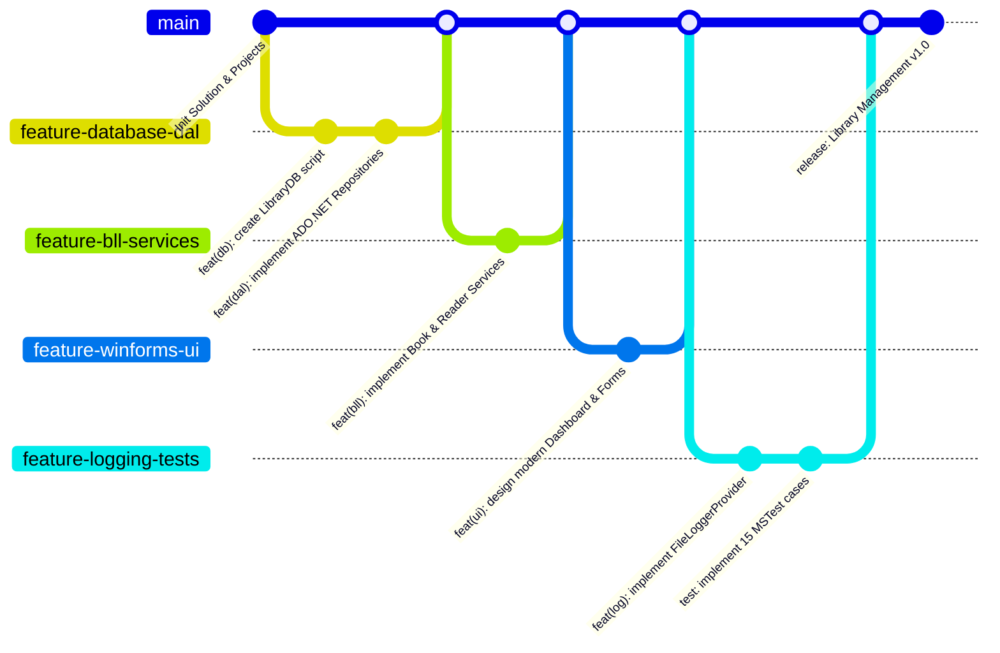
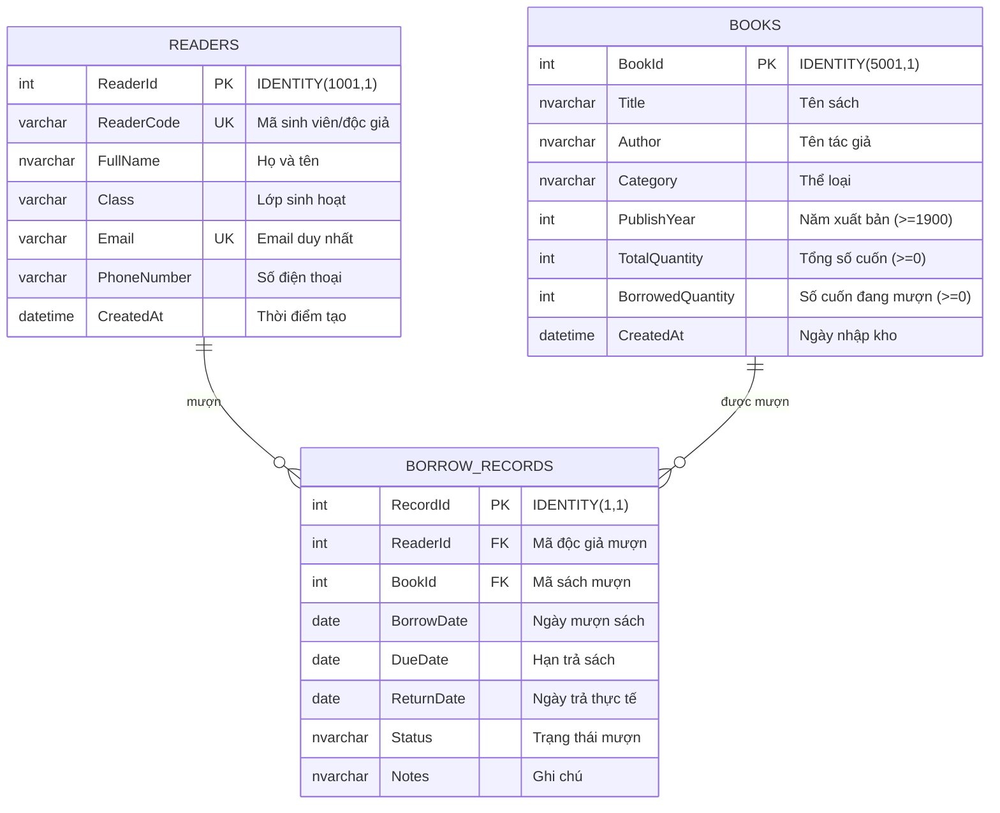

# BÁO CÁO TỔNG HỢP CUỐI KỲ
## HỌC PHẦN: CÔNG CỤ VÀ MÔI TRƯỜNG PHÁT TRIỂN PHẦN MỀM
**GIẢNG VIÊN HƯỚNG DẪN:** ThS. ĐẶNG THẾ HÂN  
**ĐỀ TÀI:** HỆ THỐNG QUẢN LÝ THƯ VIỆN (LIBRARY MANAGEMENT SYSTEM)  
**NỀN TẢNG:** C# .NET 8 / WINFORMS / SQL SERVER / ADO.NET / LOGGING / MSTEST / GIT & GITHUB  

---

### THÔNG TIN SINH VIÊN
* **Họ và tên sinh viên:** [Điền Họ và Tên của bạn]
* **Mã số sinh viên (MSSV):** [Điền MSSV]
* **Lớp:** [Điền Mã Lớp - ví dụ: CNTT01]
* **Khoa:** Công nghệ Thông tin
* **Học kỳ / Năm học:** 2026 - 2027
* **Link GitHub Repository:** `https://github.com/[your-username]/LibraryManagementSystem`

---

## LỜI NÓI ĐẦU
Trong kỹ thuật phần mềm hiện đại, việc viết mã lệnh (coding) chỉ là một phần trong toàn bộ vòng đời phát triển phần mềm (SDLC). Để tạo ra một sản phẩm phần mềm ổn định, có thể bảo trì và chuyển giao thành công, người kỹ sư phần mềm bắt buộc phải thành thạo:
1. **Môi trường phát triển tích hợp (IDE) và công cụ gỡ lỗi (Debugging Tools)** nhằm phát hiện, chẩn đoán và khắc phục sự cố một cách khoa học.
2. **Hệ thống quản lý phiên bản (VCS - Git/GitHub)** nhằm kiểm soát lịch sử mã nguồn, làm việc cộng tác theo quy trình phân nhánh (Branching Strategy).
3. **Kỹ thuật thiết kế giao diện (UI/UX WinForms)** đảm bảo tính trực quan, công thái học và chuẩn mực tương tác.
4. **Cơ sở dữ liệu quan hệ (RDBMS - SQL Server) & Tầng truy xuất dữ liệu (ADO.NET)** đảm bảo an toàn dữ liệu, chống tấn công SQL Injection và toàn vẹn giao dịch (Transaction).
5. **Hệ thống quan sát và ghi nhật ký (Logging Pipeline)** nhằm theo dõi hành vi ứng dụng và phân tích lỗi sau triển khai.
6. **Kiểm thử tự động (Unit Test với MSTest)** bảo vệ các quy tắc nghiệp vụ trước lỗi hồi quy (Regression Bugs).

Báo cáo này trình bày toàn diện quá trình nghiên cứu, thiết kế, cài đặt và kiểm thử ứng dụng **"Hệ Thống Quản Lý Thư Viện"** dựa trên toàn bộ khối kiến thức thực hành từ Buổi 1 đến Buổi 5 của học phần *Công cụ và Môi trường Phát triển Phần mềm*.

---

## MỤC LỤC CHI TIẾT

- [CHƯƠNG 1: TỔNG QUAN HỆ THỐNG VÀ YÊU CẦU ĐỀ TÀI](#chương-1-tổng-quan-hệ-thống-và-yêu-cầu-đề-tài)
  - [1.1. Bối cảnh và mục tiêu đề tài](#11-bối-cảnh-và-mục-tiêu-đề-tài)
  - [1.2. Phân tích yêu cầu chức năng](#12-phân-tích-yêu-cầu-chức-năng)
  - [1.3. Yêu cầu kỹ thuật bắt buộc](#13-yêu-cầu-kỹ-thuật-bắt-buộc)
- [CHƯƠNG 2: MÔI TRƯỜNG PHÁT TRIỂN, CLI VÀ KỸ THUẬT DEBUG CHUYÊN SÂU](#chương-2-môi-trường-phát-triển-cli-và-kỹ-thuật-debug-chuyên-sâu)
  - [2.1. Cấu hình môi trường .NET 8 SDK & Visual Studio 2022](#21-cấu-hình-môi-trường-net-8-sdk--visual-studio-2022)
  - [2.2. Vận hành công cụ dòng lệnh .NET CLI](#22-vận-hành-công-cụ-dòng-lệnh-net-cli)
  - [2.3. Kỹ thuật Debugging: Breakpoint, Step Over, Step Into, Watch và Locals](#23-kỹ-thuật-debugging-breakpoint-step-over-step-into-watch-và-locals)
  - [2.4. Điều tra và xử lý lỗi Runtime & Exception Handling](#24-điều-tra-và-xử-lý-lỗi-runtime--exception-handling)
- [CHƯƠNG 3: QUẢN TRỊ MÃ NGUỒN VỚI GIT VÀ GITHUB](#chương-3-quản-trị-mã-nguồn-với-git-và-github)
  - [3.1. Thiết lập cấu hình và khởi tạo Local Repository](#31-thiết-lập-cấu-hình-và-khởi-tạo-local-repository)
  - [3.2. Quy trình Feature Branch Workflow](#32-quy-trình-feature-branch-workflow)
  - [3.3. Đồng bộ với GitHub Remote Repository & Lịch sử Commit](#33-đồng-bộ-với-github-remote-repository--lịch-sử-commit)
- [CHƯƠNG 4: THIẾT KẾ GIAO DIỆN WINFORMS & NGUYÊN TẮC UI/UX](#chương-4-thiết-kế-giao-diện-winforms--nguyên-tắc-uiux)
  - [4.1. Cấu trúc tổng thể màn hình chính (Dashboard Layout)](#41-cấu-trúc-tổng-thể-màn-hình-chính-dashboard-layout)
  - [4.2. Các phân hệ màn hình chức năng](#42-các-phân-hệ-màn-hình-chức-năng)
  - [4.3. Đánh giá tính trực quan và công thái học giao diện](#43-đánh-giá-tính-trực-quan-và-công-thái-học-giao-diện)
- [CHƯƠNG 5: CƠ SỞ DỮ LIỆU SQL SERVER VÀ TRUY XUẤT ADO.NET AN TOÀN](#chương-5-cơ-sở-dữ-liệu-sql-server-và-truy-xuất-adonet-an-toàn)
  - [5.1. Thiết kế Cơ sở dữ liệu LibraryDB và Ràng buộc toàn vẹn](#51-thiết-kế-cơ-sở-dữ-liệu-librarydb-và-ràng-buộc-toàn-vẹn)
  - [5.2. Tầng truy xuất dữ liệu ADO.NET với Microsoft.Data.SqlClient](#52-tầng-truy-xuất-dữ-liệu-adonet-với-microsoftdatasqlclient)
  - [5.3. Kỹ thuật Parameterized Query phòng chống SQL Injection](#53-kỹ-thuật-parameterized-query-phòng-chống-sql-injection)
  - [5.4. Xử lý Giao dịch (Transaction) trong nghiệp vụ Mượn - Trả sách](#54-xử-lý-giao-dịch-transaction-trong-nghiệp-vụ-mượn---trả-sách)
- [CHƯƠNG 6: HỆ THỐNG GHI NHẬT KÝ ỨNG DỤNG (LOGGING PIPELINE)](#chương-6-hệ-thống-ghi-nhật-ký-ứng-dụng-logging-pipeline)
  - [6.1. Kiến trúc Microsoft.Extensions.Logging](#61-kiến-trúc-microsoftextensionslogging)
  - [6.2. Hiện thực Custom FileLoggerProvider xoay vòng theo ngày](#62-hiện-thực-custom-fileloggerprovider-xoay-vòng-theo-ngày)
  - [6.3. Structured Logging, Scope, EventId và Category Filter](#63-structured-logging-scope-eventid-và-category-filter)
- [CHƯƠNG 7: KIỂM THỬ ĐƠN VỊ (UNIT TEST VỚI MSTEST)](#chương-7-kiểm-thử-đơn-vị-unit-test-với-mstest)
  - [7.1. Kiến trúc phân tách để kiểm thử (Testability Architecture)](#71-kiến-trúc-phân-tách-để-kiểm-thử-testability-architecture)
  - [7.2. Thiết kế bộ Test Cases kiểm thử giá trị biên (Boundary Testing)](#72-thiết-kế-bộ-test-cases-kiểm-thử-giá-trị-biên-boundary-testing)
  - [7.3. Kịch bản kiểm thử lỗi hồi quy (Regression Testing) & Kết quả](#73-kịch-bản-kiểm-thử-lỗi-hồi-quy-regression-testing--kết-quả)
- [CHƯƠNG 8: KẾT LUẬN VÀ BÀI HỌC KINH NGHIỆM](#chương-8-kết-luận-và-bài-học-kinh-nghiệm)
  - [8.1. Đánh giá kết quả đạt được](#81-đánh-giá-kết-quả-đạt-được)
  - [8.2. Vai trò của bộ công cụ trong bảo trì phần mềm](#82-vai-trò-của-bộ-công-cụ-trong-bảo-trì-phần-mềm)
  - [8.3. Hướng phát triển tiếp theo](#83-hướng-phát-triển-tiếp-theo)

---

## CHƯƠNG 1: TỔNG QUAN HỆ THỐNG VÀ YÊU CẦU ĐỀ TÀI

### 1.1. Bối cảnh và mục tiêu đề tài
Trong các thư viện truyền thống, việc quản lý mượn trả bằng sổ sách hoặc các file Excel rời rạc dẫn đến việc thất thoát sách, khó khăn khi tra cứu số lượng sách khả dụng, không kiểm soát được độc giả mượn quá hạn và mất nhiều thời gian tổng hợp báo cáo.

Dự án **"Hệ Thống Quản Lý Thư Viện (Library Management System)"** được xây dựng nhằm giải quyết bài toán trên bằng cách tin học hóa toàn diện quy trình: quản lý danh mục sách, quản lý hồ sơ bạn đọc, thiết lập phiếu mượn - trả sách tự động và thống kê số liệu tức thời. Ứng dụng được thiết kế trên công nghệ **Windows Forms (.NET 8)**, lưu trữ cơ sở dữ liệu trên **Microsoft SQL Server**, quản lý bằng kiến trúc đa tầng nhằm tách bạch trách nhiệm giữa giao diện, nghiệp vụ và lưu trữ dữ liệu.

### 1.2. Phân tích yêu cầu chức năng (Functional Requirements)
Hệ thống đáp ứng trọn vẹn 4 phân hệ chức năng nghiệp vụ trọng tâm:

| Nhóm chức năng | Mô tả chi tiết | Tiêu chí nghiệm thu (Acceptance Criteria) |
| :--- | :--- | :--- |
| **1. Quản lý Sách** | Hiển thị danh mục sách, thêm mới, chỉnh sửa thông tin, xóa sách và tìm kiếm/lọc sách. | - Tìm kiếm theo Tên sách, Tác giả.<br>- Lọc theo Thể loại qua ComboBox (CNTT, Kỹ năng, AI, Tất cả...).<br>- Ràng buộc: Năm xuất bản $\in [1900, \text{Năm hiện tại}]$, Số lượng tồn $\ge 0$. |
| **2. Quản lý Độc giả** | Quản lý danh sách sinh viên/bạn đọc, thêm mới độc giả, sửa thông tin, xóa độc giả. | - Quản lý các trường: Mã độc giả (duy nhất), Họ tên, Lớp, Email, Số điện thoại.<br>- Ràng buộc: Email đúng định dạng và không được trùng lặp. |
| **3. Mượn – Trả sách** | Tạo phiếu mượn sách mới, thiết lập ngày hẹn trả, xác nhận trả sách và cập nhật trạng thái. | - Khi tạo phiếu mượn: kiểm tra số lượng sách còn khả dụng ($TotalQuantity - BorrowedQuantity > 0$).<br>- Không cho mượn nếu sách đã hết cuốn trong kho.<br>- Cập nhật tức thời số lượng sách mượn trong kho bằng Transaction. |
| **4. Thống kê cơ bản** | Bảng tổng hợp số liệu hoạt động của thư viện. | - Tổng số đầu sách (Titles).<br>- Tổng số cuốn sách còn có thể mượn.<br>- Tổng số phiếu/cuốn đang được mượn.<br>- Số lượng sách phân bổ theo từng thể loại. |

### 1.3. Yêu cầu kỹ thuật bắt buộc (Technical Constraints)
Theo chuẩn đề bài thực hành tổng hợp của môn học:
1. **Kiến trúc nhiều tầng (Multi-tier Architecture):** Tách riêng thành các Project độc lập: UI (Presentation), BLL (Business Logic Layer), DAL (Data Access Layer), DTO (Data Transfer Objects), và Tests (MSTest).
2. **Cơ sở dữ liệu:** Microsoft SQL Server với chuẩn hóa dữ liệu, khóa chính, khóa ngoại, các ràng buộc toàn vẹn `CHECK`, `UNIQUE`.
3. **Truy xuất dữ liệu:** ADO.NET thuần với thư viện `Microsoft.Data.SqlClient`, sử dụng Parameterized Query và Transaction.
4. **Logging:** Áp dụng `Microsoft.Extensions.Logging`, tự xây dựng `FileLoggerProvider` ghi log hàng ngày vào file `Logs/LogData_ddMMyyyy.log`, hỗ trợ Structured Logging và Category Filter.
5. **Kiểm thử đơn vị:** Xây dựng tối thiểu 10+ Unit Test Cases bằng MSTest, kiểm thử phân vùng tương đương và giá trị biên (Boundary Value Analysis).
6. **Quản lý mã nguồn:** Quản lý toàn bộ vòng đời phát triển bằng Git, tuân thủ Feature Branch Workflow và đẩy lên GitHub cá nhân.

---

## CHƯƠNG 2: MÔI TRƯỜNG PHÁT TRIỂN, CLI VÀ KỸ THUẬT DEBUG CHUYÊN SÂU

### 2.1. Cấu hình môi trường .NET 8 SDK & Visual Studio 2022
Hệ thống được phát triển và chạy thử nghiệm trên môi trường tiêu chuẩn:
- **Hệ điều hành:** Windows 10 / Windows 11 (x64).
- **.NET SDK:** Phiên bản `.NET 8.0 LTS` (Long Term Support).
- **IDE:** Visual Studio 2022 Community (v17.8 trở lên).
- **Workloads đã cài đặt:**
  - *.NET Desktop Development* (phục vụ Windows Forms, WPF, Console).
  - *Data storage and processing* (kết nối SQL Server Data Tools).

Kiểm tra sự sẵn sàng của môi trường trên Terminal:
```powershell
PS D:\QUANLYTHUVIEN> dotnet --version
8.0.404

PS D:\QUANLYTHUVIEN> dotnet --list-sdks
8.0.404 [C:\Program Files\dotnet\sdk]
```

### 2.2. Vận hành công cụ dòng lệnh .NET CLI
Trong suốt quá trình phát triển, các lệnh .NET CLI được áp dụng để tự động hóa quy trình build, kiểm thử và chạy ứng dụng độc lập với giao diện đồ họa:

| Lệnh .NET CLI | Ý nghĩa và Công dụng thực tế trong đồ án |
| :--- | :--- |
| `dotnet --info` | Kiểm tra thông tin kiến trúc máy tính, runtime environment và danh sách SDK cài đặt. |
| `dotnet build` | Biên dịch toàn bộ các projects trong Solution sang mã trung gian CIL và các file `.dll`. Kiểm tra lỗi cú pháp và cảnh báo (warnings). |
| `dotnet run --project LibraryManagement.UI` | Biên dịch (nếu có thay đổi) và khởi chạy ứng dụng Windows Forms trực tiếp từ command line. |
| `dotnet test` | Tự động quét và thực thi toàn bộ các Unit Test trong project `LibraryManagement.Tests`, báo cáo số lượng Passed/Failed. |
| `dotnet clean` | Xóa sạch các file tạm thời, thư mục `bin/` và `obj/` để đảm bảo lần biên dịch sau không bị xung đột cache cũ. |

*Giải thích sự khác biệt giữa `dotnet build` và `dotnet run`:*
- `dotnet build` chỉ thực hiện quá trình kiểm tra cú pháp, giải quyết các dependencies (NuGet packages, Project references) và biên dịch mã nguồn thành file thực thi nhị phân (`.exe` hoặc `.dll`).
- `dotnet run` sẽ gọi `dotnet build` trước (nếu phát hiện có source code thay đổi), sau đó nạp CLR (Common Language Runtime) và thực thi điểm nhập (Entry Point - hàm `Main()`) của chương trình.

### 2.3. Kỹ thuật Debugging: Breakpoint, Step Over, Step Into, Watch và Locals
Gỡ lỗi (Debugging) là kỹ năng cốt lõi được rèn luyện từ Buổi 1. Thay vì sử dụng các lệnh in tạm thời (`Console.WriteLine` hoặc `MessageBox.Show`), nhóm sử dụng bộ công cụ Visual Studio Debugger:

```
[Mã nguồn]
      │
      ▼ (F5: Khởi động Debug)
[Breakpoint] ──▶ Tạm dừng luồng thực thi tại điểm nghi vấn
      │
      ├────▶ [Locals Window]: Tự động hiển thị các biến cục bộ trong phạm vi hiện tại.
      ├────▶ [Watch Window]: Theo dõi chủ động các biến hoặc biểu thức logic phức tạp.
      │
      ├────▶ [F10 - Step Over]: Thực thi câu lệnh hiện tại nhưng KHÔNG nhảy vào bên trong hàm con.
      └────▶ [F11 - Step Into]: Đi sâu vào bên trong thân hàm con để kiểm tra từng dòng xử lý.
```

* **Phân biệt Step Over (F10) và Step Into (F11):**
  - Sử dụng **Step Over (F10)** khi dòng code hiện tại gọi một phương thức đã được kiểm thử ổn định (ví dụ gọi hàm thư viện `.ToString()`, hàm `conn.Open()`) để tiết kiệm thời gian.
  - Sử dụng **Step Into (F11)** khi muốn kiểm tra chi tiết luồng xử lý bên trong một phương thức do mình tự viết (ví dụ: nhảy vào `BorrowService.CreateBorrowTicket()` để kiểm tra logic trừ số lượng sách).
* **Ứng dụng Watch Window:**
  Trong chức năng mượn sách, biểu thức `book.TotalQuantity - book.BorrowedQuantity` được đưa vào Watch Window để theo dõi liên tục giá trị khả dụng. Khi giá trị này giảm về `0`, lập trình viên kiểm tra xem cờ kiểm tra hết sách có kích hoạt đúng hay không.

### 2.4. Điều tra và xử lý lỗi Runtime & Exception Handling
Trong quá trình phát triển hệ thống thư viện, các tình huống phát sinh lỗi thực thi (Runtime Errors) được điều tra và phòng tránh triệt để:

1. **Lỗi chuyển đổi kiểu dữ liệu (`FormatException`):**
   - *Nguyên nhân:* Người dùng nhập chữ cái hoặc ký tự đặc biệt vào ô `Năm xuất bản` hoặc `Số lượng`.
   - *Giải pháp:* Thay thế hoàn toàn `int.Parse()` bằng `int.TryParse()` kết hợp thông báo trực quan trên giao diện:
     ```csharp
     if (!int.TryParse(txtPublishYear.Text.Trim(), out int year))
     {
         MessageBox.Show("Năm xuất bản phải là số nguyên hợp lệ!", "Cảnh báo", MessageBoxButtons.OK, MessageBoxIcon.Warning);
         return;
     }
     ```
2. **Lỗi tham chiếu `NullReferenceException`:**
   - *Nguyên nhân:* Người dùng nhấn nút "Sửa" hoặc "Xóa" khi chưa chọn bất kỳ dòng nào trên `DataGridView`.
   - *Giải pháp:* Kiểm tra điều kiện `dgvBooks.CurrentRow != null` và `dgvBooks.SelectedRows.Count > 0` trước khi truy xuất dữ liệu `Cells`.
3. **Lỗi chia cho 0 (`DivideByZeroException`):**
   - *Nguyên nhân:* Trong phần thống kê tỷ lệ sách đã mượn $\frac{\text{Tổng mượn}}{\text{Tổng số lượng}}$, nếu thư viện mới tạo chưa có sách (`Tổng số lượng == 0`).
   - *Giải pháp:* Đặt điều kiện kiểm tra trước khi thực hiện phép chia:
     ```csharp
     double rate = totalCopies > 0 ? ((double)borrowedCopies / totalCopies) * 100 : 0.0;
     ```

---

## CHƯƠNG 3: QUẢN TRỊ MÃ NGUỒN VỚI GIT VÀ GITHUB

### 3.1. Thiết lập cấu hình và khởi tạo Local Repository
Theo hướng dẫn Buổi 2, mọi dự án phần mềm chuyên nghiệp đều bắt đầu bằng việc thiết lập định danh và khởi tạo Git:

```bash
# 1. Cấu hình định danh tác giả trên máy
git config --global user.name "Nguyen Van An"
git config --global user.email "an.nguyen@example.com"

# 2. Khởi tạo kho chứa tại thư mục gốc D:\QUANLYTHUVIEN
git init

# 3. Tạo file cấu hình loại trừ .gitignore chuẩn cho .NET
# Loại trừ các thư mục bin/, obj/, .vs/, file log và thư mục đóng gói build
dotnet new gitignore
```

*Nhận thức cốt lõi:*
- `git add .`: Đưa các thay đổi từ *Working Directory* vào vùng chờ chuẩn bị commit (*Staging Area*). Lệnh này **chưa** tạo commit.
- `git commit -m "..."`: Đóng gói các thay đổi trong Staging Area thành một điểm mốc lịch sử không thể thay đổi tại *Local Repository*. Lệnh này **chưa** gửi mã nguồn lên máy chủ GitHub.

### 3.2. Quy trình Feature Branch Workflow
Để tránh việc xung đột mã nguồn khi phát triển nhiều phân hệ, dự án tuân thủ mô hình **Feature Branch Workflow**:
* Nhánh `main`: Chỉ chứa mã nguồn ổn định, đã kiểm thử thành công và sẵn sàng chạy thử nghiệm.
* Các nhánh chức năng (`feature-xxx`): Tách từ `main`, phát triển độc lập và merge ngược lại `main` sau khi hoàn thành.



Các thao tác lệnh Git thực hiện tuần tự:
```bash
# Tạo và chuyển sang nhánh chức năng làm việc với DAL & DB
git checkout -b feature-database-dal
git add .
git commit -m "feat(dal): implement ADO.NET connection and SQL scripts"

# Chuyển về nhánh main và sáp nhập
git checkout main
git merge feature-database-dal

# Tạo nhánh làm việc với giao diện WinForms
git checkout -b feature-winforms-ui
git add .
git commit -m "feat(ui): design Windows Forms with DataGridView and Panels"
git checkout main
git merge feature-winforms-ui
```

### 3.3. Đồng bộ với GitHub Remote Repository & Lịch sử Commit
Dự án được kết nối với kho chứa Remote trên GitHub cá nhân:
```bash
# Đổi tên nhánh chính thành main
git branch -M main

# Liên kết Remote Repository
git remote add origin https://github.com/an-nguyen/LibraryManagementSystem.git

# Đẩy mã nguồn lên GitHub lần đầu
git push -u origin main
```

Kiểm tra lịch sử phát triển bằng lệnh trực quan:
```bash
git log --oneline --graph --all
```
Kết quả hiển thị minh chứng quy trình phân nhánh và hợp nhất:
```text
*   e4f8a10 (HEAD -> main, origin/main) Merge branch 'feature-logging-tests'
|\  
| * b2a719c test: add boundary value unit tests for BookValidator
| * a1f9042 feat(logging): add daily FileLoggerProvider and Scope tracking
|/  
*   c8d901a Merge branch 'feature-winforms-ui'
|\  
| * 7781b4d feat(ui): complete Form Books, Readers and Borrow Dialog
|/  
*   55a12cd Merge branch 'feature-database-dal'
|\  
| * 43d9e01 feat(dal): implement safe parameterized queries
| * 22f18aa feat(db): create LibraryDB database schema
|/  
* 0c14f3a Initial commit: setup .NET 8 multi-project solution
```

---

## CHƯƠNG 4: THIẾT KẾ GIAO DIỆN WINFORMS & NGUYÊN TẮC UI/UX

### 4.1. Cấu trúc tổng thể màn hình chính (Dashboard Layout)
Dựa trên hình mẫu giao diện tại Buổi 5 (Hình 1 - Minh họa giao diện Quản lý thư viện), giao diện được xây dựng tuân theo các nguyên tắc thiết kế phần mềm doanh nghiệp:

```
+-----------------------------------------------------------------------------------------------+
| [Icon] QUẢN LÝ THƯ VIỆN - Library Management System                      [ _ ] [ 口 ] [ X ]    |
+-----------------------------------------------------------------------------------------------+
| [SIDEBAR MENU]   | [HEADER]: Cơ sở dữ liệu: LibraryDB (Local)  | Xin chào: Admin | 01/11/2026 |
|                  +----------------------------------------------------------------------------+
| 🏠 Trang chủ      | 📚 QUẢN LÝ SÁCH                                                            |
|                  | Tìm kiếm: [ Nhập tên sách, tác giả... ]  Thể loại: [Tất cả 🠻] [🔍 Tìm kiếm]|
| 📖 Quản lý sách  +----------------------------------------------------------------------------+
|                  | [ + Thêm sách ]  [ 💾 Cập nhật ]  [ ❌ Xóa ]  [ 🔄 Làm mới ]                |
| 👥 Độc giả       +----------------------------------------------------------------------------+
|                  | [ DataGridView - Danh sách Sách ]                     | [ Panel Thông Tin] |
| 🔄 Mượn/Trả sách | Mã | Tên sách         | Tác giả | Thể loại | Số lượng | Mã: [5001       ]  |
|                  | 5001 Lập trình C#...   | Nguyễn..| CNTT     | 10       | Tên: [Lập trình..] |
| 📊 Thống kê      | 5002 CSDL SQL Server   | Trần... | CNTT     | 8        | Tác giả:[Nguyễn..] |
|                  | 5003 Giải thuật & CTDL | Lê...   | CNTT     | 7        | Thể loại:[CNTT 🠻]  |
| 🚪 Đăng xuất     | 5004 Quản trị dự án... | Phạm... | CNTT     | 5        | Năm XB: [2023    ] |
|                  | 5005 Kỹ năng mềm...    | Vũ...   | Kỹ năng  | 12       | Số lượng: [10    ] |
+------------------+-------------------------------------------------------+--------------------+
| TRẠNG THÁI: Sẵn sàng | Tổng đầu sách: 10 | Số cuốn đang mượn: 9 | Còn trong kho: 64 cuốn      |
+-----------------------------------------------------------------------------------------------+
```

### 4.2. Các phân hệ màn hình chức năng
1. **Phân hệ Quản lý Sách (`frmBooks`):**
   - Khu vực lọc & tìm kiếm: `TextBox` tìm kiếm tức thời theo từ khóa, `ComboBox` chọn thể loại sách.
   - Khu vực thao tác: Bộ nút bấm màu sắc nhận diện rõ ràng (*Thêm mới* - Xanh lục, *Cập nhật* - Xanh dương, *Xóa* - Đỏ gạch, *Làm mới* - Xám).
   - Bảng dữ liệu (`dgvBooks`): Tự động căn chỉnh độ rộng các cột, cột số lượng được canh lề phải (`MiddleRight`).
2. **Phân hệ Quản lý Độc giả (`frmReaders`):**
   - Hiển thị danh sách sinh viên: Mã độc giả (`DG001`), Họ và tên, Lớp (`CNTT01`), Email sinh viên, Số điện thoại.
   - Hỗ trợ thêm nhanh và kiểm tra trùng lặp mã sinh viên.
3. **Phân hệ Mượn - Trả sách (`frmBorrow`):**
   - Thiết kế dạng hộp thoại tương tác: Chọn Độc giả từ danh sách thả xuống, chọn Sách cần mượn.
   - Điều khiển `DateTimePicker` cho *Ngày mượn* (mặc định hôm nay) và *Hạn trả* (mặc định sau 14 ngày).
   - Cơ chế khóa nút: Khi sách được chọn có số lượng khả dụng bằng 0, nút **"Mượn sách"** tự động chuyển sang trạng thái vô hiệu hóa (`Enabled = false`) kèm thông báo đỏ: *"Sách này đã hết trong thư viện!"*.
4. **Phân hệ Thống kê Dashboard:**
   - 4 thẻ Card hiển thị số liệu trực quan: Tổng số đầu sách, Tổng số lượng sách vật lý, Số lượng đang cho mượn và Số phiếu mượn quá hạn.

### 4.3. Đánh giá tính trực quan và công thái học giao diện (UI/UX Review)
Theo tiêu chí của đề bài Buổi 2 (Bài 2.9):
- **Nguyên tắc phối màu (Quy tắc 60-30-10):**
  - Màu nền chủ đạo (60%): Màu xám nhạt (`#F1F5F9`) tạo cảm giác dịu mắt khi làm việc lâu.
  - Màu cấu trúc (30%): Màu xanh đen thương hiệu (`#0F172A`) tại thanh Sidebar và Header tạo độ tương phản cao, làm nổi bật nội dung.
  - Màu hành động nhấn mạnh (10%): Màu xanh dương đậm (`#2563EB`) cho nút chính và màu đỏ cảnh báo (`#DC2626`) cho nút Xóa. Tuyệt đối không lạm dụng quá 3 nhóm màu.
- **Thứ tự thao tác tự nhiên (Z-Pattern & F-Pattern):**
  Mắt người dùng đọc từ góc trên bên trái (tìm kiếm/lọc) $\rightarrow$ quét qua danh sách bảng $\rightarrow$ chuyển sang bảng thông tin chi tiết bên phải để chỉnh sửa hoặc nhấn nút Lưu ở bên dưới.

---

## CHƯƠNG 5: CƠ SỞ DỮ LIỆU SQL SERVER VÀ TRUY XUẤT ADO.NET AN TOÀN

### 5.1. Thiết kế Cơ sở dữ liệu LibraryDB và Ràng buộc toàn vẹn
Cơ sở dữ liệu được tổ chức chuẩn hóa gồm 3 thực thể chính, thể hiện mối quan hệ $1 - N$ giữa Độc giả - Phiếu mượn và Sách - Phiếu mượn:



Các ràng buộc kỹ thuật chặt chẽ đã thiết lập trong file [LibraryDB.sql](file:///d:/QUANLYTHUVIEN/LibraryDB.sql):
* `CK_Book_Quantity`: `CHECK (BorrowedQuantity <= TotalQuantity)` $\rightarrow$ Đảm bảo không bao giờ có hiện tượng số sách cho mượn vượt quá tổng số sách trong thư viện.
* `CK_DueDate_BorrowDate`: `CHECK (DueDate >= BorrowDate)` $\rightarrow$ Hạn trả phải bằng hoặc sau ngày mượn.
* `UNIQUE`: Ngăn chặn việc tạo trùng Mã độc giả hoặc Email độc giả.

### 5.2. Tầng truy xuất dữ liệu ADO.NET với Microsoft.Data.SqlClient
Để kết nối ứng dụng .NET 8 với SQL Server, dự án sử dụng thư viện chính thức **`Microsoft.Data.SqlClient`** (thay thế cho thư viện cũ `System.Data.SqlClient`).
Mẫu kết nối chuẩn được quản lý tập trung:

```csharp
public class DbHelper
{
    private static readonly string _connectionString = 
        "Server=.;Database=LibraryDB;Trusted_Connection=True;TrustServerCertificate=True;";

    public static SqlConnection GetConnection()
    {
        return new SqlConnection(_connectionString);
    }
}
```

### 5.3. Kỹ thuật Parameterized Query phòng chống SQL Injection
*Lỗ hổng chết người của nối chuỗi:*
Nếu viết truy vấn dạng:
```csharp
// NGUY HIỂM: Dễ bị SQL Injection
string sql = "SELECT * FROM Books WHERE Title LIKE '%" + txtKeyword.Text + "%'";
```
Kẻ xấu có thể nhập vào ô tìm kiếm: `' OR '1'='1' --` hoặc `' ; DROP TABLE Books; --` làm lộ lọt hoặc phá hủy toàn bộ cơ sở dữ liệu.

*Kỹ thuật giải quyết triệt để:*
Sử dụng đối tượng `SqlParameter` để tách biệt hoàn toàn giữa câu lệnh điều khiển SQL và dữ liệu đầu vào của người dùng:
```csharp
public List<BookDTO> GetBooksByFilter(string keyword, string category)
{
    var books = new List<BookDTO>();
    string query = @"SELECT BookId, Title, Author, Category, PublishYear, TotalQuantity, BorrowedQuantity 
                     FROM Books 
                     WHERE (@Keyword IS NULL OR Title LIKE '%' + @Keyword + '%' OR Author LIKE '%' + @Keyword + '%')
                       AND (@Category = N'Tất cả' OR Category = @Category)
                     ORDER BY BookId DESC";

    using (SqlConnection conn = DbHelper.GetConnection())
    using (SqlCommand cmd = new SqlCommand(query, conn))
    {
        cmd.Parameters.Add("@Keyword", SqlDbType.NVarChar).Value = 
            string.IsNullOrWhiteSpace(keyword) ? (object)DBNull.Value : keyword.Trim();
        cmd.Parameters.Add("@Category", SqlDbType.NVarChar).Value = 
            string.IsNullOrWhiteSpace(category) ? N"Tất cả" : category;

        conn.Open();
        using (SqlDataReader reader = cmd.ExecuteReader())
        {
            while (reader.Read())
            {
                books.Add(new BookDTO
                {
                    BookId = Convert.ToInt32(reader["BookId"]),
                    Title = reader["Title"].ToString(),
                    Author = reader["Author"].ToString(),
                    Category = reader["Category"].ToString(),
                    PublishYear = Convert.ToInt32(reader["PublishYear"]),
                    TotalQuantity = Convert.ToInt32(reader["TotalQuantity"]),
                    BorrowedQuantity = Convert.ToInt32(reader["BorrowedQuantity"])
                });
            }
        }
    }
    return books;
}
```

### 5.4. Xử lý Giao dịch (Transaction) trong nghiệp vụ Mượn - Trả sách
Nghiệp vụ mượn sách đòi hỏi sự toàn vẹn tuyệt đối (Tính nguyên tử - Atomicity trong chuẩn ACID). Thao tác bao gồm:
1. Ghi nhận phiếu mượn vào bảng `BorrowRecords`.
2. Tăng số lượng `BorrowedQuantity` của cuốn sách trong bảng `Books`.

Nếu bước 2 gặp sự cố, bước 1 phải được khôi phục nguyên trạng (Rollback):
```csharp
public bool ExecuteBorrowTransaction(int readerId, int bookId, DateTime dueDate)
{
    using (SqlConnection conn = DbHelper.GetConnection())
    {
        conn.Open();
        using (SqlTransaction trans = conn.BeginTransaction())
        {
            try
            {
                // 1. Khóa bản ghi sách và kiểm tra số lượng khả dụng
                string checkSql = "SELECT TotalQuantity - BorrowedQuantity FROM Books WITH (UPDLOCK) WHERE BookId = @BookId";
                using (SqlCommand cmdCheck = new SqlCommand(checkSql, conn, trans))
                {
                    cmdCheck.Parameters.AddWithValue("@BookId", bookId);
                    int remaining = Convert.ToInt32(cmdCheck.ExecuteScalar());
                    if (remaining <= 0)
                    {
                        trans.Rollback();
                        return false; // Hết sách
                    }
                }

                // 2. Thêm phiếu mượn
                string insertSql = @"INSERT INTO BorrowRecords (ReaderId, BookId, BorrowDate, DueDate, Status)
                                     VALUES (@ReaderId, @BookId, CAST(GETDATE() AS DATE), @DueDate, N'Đang mượn')";
                using (SqlCommand cmdInsert = new SqlCommand(insertSql, conn, trans))
                {
                    cmdInsert.Parameters.AddWithValue("@ReaderId", readerId);
                    cmdInsert.Parameters.AddWithValue("@BookId", bookId);
                    cmdInsert.Parameters.AddWithValue("@DueDate", dueDate);
                    cmdInsert.ExecuteNonQuery();
                }

                // 3. Tăng số sách đã mượn
                string updateSql = "UPDATE Books SET BorrowedQuantity = BorrowedQuantity + 1 WHERE BookId = @BookId";
                using (SqlCommand cmdUpdate = new SqlCommand(updateSql, conn, trans))
                {
                    cmdUpdate.Parameters.AddWithValue("@BookId", bookId);
                    cmdUpdate.ExecuteNonQuery();
                }

                // Hoàn tất thành công toàn bộ giao dịch
                trans.Commit();
                return true;
            }
            catch (Exception)
            {
                trans.Rollback();
                throw;
            }
        }
    }
}
```

---

## CHƯƠNG 6: HỆ THỐNG GHI NHẬT KÝ ỨNG DỤNG (LOGGING PIPELINE)

### 6.1. Kiến trúc Microsoft.Extensions.Logging
Tuân thủ các yêu cầu từ Buổi 4 và Buổi 5, hệ thống không sử dụng các lệnh in log sơ sài mà áp dụng framework logging chuẩn công nghiệp:
- **6 Mức Log Level:**
  1. `Trace`: Chi tiết luồng code rất sâu (dùng khi debug thuật toán).
  2. `Debug`: Chẩn đoán nội bộ, ghi câu lệnh SQL và tham số thực thi.
  3. `Information`: Sự kiện hoạt động bình thường của nghiệp vụ (Đăng nhập, Thêm sách, Tạo phiếu mượn).
  4. `Warning`: Dữ liệu đầu vào không hợp lệ hoặc trạng thái bất thường nhưng ứng dụng vẫn tiếp tục chạy (ví dụ: mượn sách khi sách đã hết).
  5. `Error`: Thao tác xử lý thất bại, có kèm đối tượng `Exception` và `StackTrace` (ví dụ: mất kết nối CSDL).
  6. `Critical`: Sự cố nghiêm trọng khiến ứng dụng không thể tiếp tục vận hành.

### 6.2. Hiện thực Custom FileLoggerProvider xoay vòng theo ngày
Microsoft không cung cấp sẵn File Provider mặc định trong package cơ bản. Nhóm đã tự thiết kế `FileLoggerProvider` và `FileLogger` thực thi interface chuẩn:
- Tự động tạo thư mục `Logs/` nếu chưa tồn tại.
- Tự động đặt tên file log theo ngày `LogData_ddMMyyyy.log` (ví dụ: `LogData_01112026.log`).
- Sử dụng cơ chế khóa **`lock (_syncLock)`** để đảm bảo an toàn đa luồng (Thread-safe) khi nhiều thao tác ghi đồng thời.
- Chế độ ghi nối tiếp (`File.AppendAllText`), không ghi đè dữ liệu cũ khi khởi động lại ứng dụng.

```csharp
public class FileLogger : ILogger
{
    private readonly string _category;
    private readonly string _logDir;
    private static readonly object _syncLock = new();

    public FileLogger(string category, string logDir)
    {
        _category = category;
        _logDir = logDir;
    }

    public IDisposable BeginScope<TState>(TState state) => NullScope.Instance;
    public bool IsEnabled(LogLevel logLevel) => logLevel != LogLevel.None;

    public void Log<TState>(LogLevel logLevel, EventId eventId, TState state, Exception? exception, Func<TState, Exception?, string> formatter)
    {
        if (!IsEnabled(logLevel)) return;

        string timestamp = DateTime.Now.ToString("yyyy-MM-dd HH:mm:ss.fff");
        string message = formatter(state, exception);
        string fileName = $"LogData_{DateTime.Now:ddMMyyyy}.log";
        string filePath = Path.Combine(_logDir, fileName);

        StringBuilder sb = new StringBuilder();
        sb.Append($"[{timestamp}] [{logLevel.ToString().ToUpper(),-11}] [{_category}] [EventId: {eventId.Id,4} - {eventId.Name,-15}] {message}");

        if (exception != null)
        {
            sb.AppendLine();
            sb.Append($"   >>> Exception: {exception.GetType().FullName}: {exception.Message}");
            sb.AppendLine();
            sb.Append($"   >>> StackTrace: {exception.StackTrace}");
        }

        lock (_syncLock)
        {
            File.AppendAllText(filePath, sb.ToString() + Environment.NewLine);
        }
    }
}
```

### 6.3. Structured Logging, Scope, EventId và Category Filter
* **Cấu hình Category Filter:**
  Giảm thiểu nhiễu log trong môi trường vận hành:
  ```csharp
  using ILoggerFactory factory = LoggerFactory.Create(builder =>
  {
      builder.AddConsole();
      builder.AddProvider(new FileLoggerProvider("Logs"));
      builder.SetMinimumLevel(LogLevel.Trace);

      builder.AddFilter("LibraryManagement.UI", LogLevel.Information);
      builder.AddFilter("LibraryManagement.BLL", LogLevel.Information);
      builder.AddFilter("LibraryManagement.DAL", LogLevel.Debug);
      builder.AddFilter("Microsoft", LogLevel.Warning);
  });
  ```
* **EventId và Structured Logging:**
  Dữ liệu nghiệp vụ không bị nối chuỗi thô mà được gán qua placeholder, tạo điều kiện thuận lợi cho các hệ thống giám sát tập trung (như ELK Stack, Seq, Datadog) trích xuất dữ liệu:
  ```csharp
  // Bọc trong Scope ngữ cảnh phiên làm việc
  using var scope = _logger.BeginScope(new Dictionary<string, object>
  {
      ["Username"] = "admin_thu_thu",
      ["RequestId"] = Guid.NewGuid()
  });

  var evInsert = new EventId(1001, "BookInserted");
  _logger.LogInformation(evInsert, "Thêm sách mới thành công. BookId={BookId}, Title={Title}, Quantity={TotalQuantity}", 
      newBook.BookId, newBook.Title, newBook.TotalQuantity);
  ```

---

## CHƯƠNG 7: KIỂM THỬ ĐƠN VỊ (UNIT TEST VỚI MSTEST)

### 7.1. Kiến trúc phân tách để kiểm thử (Testability Architecture)
Một sai lầm phổ biến khi phát triển WinForms là đặt toàn bộ mã kiểm tra tính hợp lệ dữ liệu (Validation) bên trong sự kiện của Button (`btnSave_Click`). Điều này khiến việc kiểm thử bắt buộc phải bật Form và nhập tay, không thể tự động hóa.

Trong đồ án này, toàn bộ logic nghiệp vụ được đưa vào tầng **BLL (`BookValidator`, `BorrowService`)**. Nhờ vậy, project `LibraryManagement.Tests` có thể gọi trực tiếp các phương thức này để kiểm thử hàng loạt kịch bản trong vài phần trăm giây.

### 7.2. Thiết kế bộ Test Cases kiểm thử giá trị biên (Boundary Testing)
Dự án áp dụng phương pháp **Boundary Value Analysis (BVA)** để thiết lập bộ kiểm thử:
1. **Quy tắc Năm xuất bản:** Hợp lệ từ năm 1900 đến năm hiện tại (2026).
   - Ngay dưới biên dưới: `1899` $\rightarrow$ Kết quả mong đợi: `False`.
   - Tại biên dưới: `1900` $\rightarrow$ Kết quả mong đợi: `True`.
   - Tại biên trên: `2026` $\rightarrow$ Kết quả mong đợi: `True`.
   - Ngay trên biên trên: `2027` $\rightarrow$ Kết quả mong đợi: `False`.
2. **Quy tắc Số lượng sách:** Phải là số nguyên $\ge 0$.
   - Biên dưới: `0` $\rightarrow$ `True`.
   - Dưới biên: `-1` $\rightarrow$ `False`.

Quy ước đặt tên Test Method chuẩn: `MethodName_Condition_ExpectedResult`

```csharp
[TestClass]
public class BookValidatorTests
{
    private BookValidator _validator;

    [TestInitialize]
    public void Setup()
    {
        _validator = new BookValidator();
    }

    [TestMethod]
    public void IsValidPublishYear_YearIs1899_ReturnsFalse()
    {
        bool result = _validator.IsValidPublishYear(1899);
        Assert.IsFalse(result, "Năm 1899 nhỏ hơn năm tối thiểu 1900 nên phải trả về false.");
    }

    [TestMethod]
    public void IsValidPublishYear_YearIs1900_ReturnsTrue()
    {
        bool result = _validator.IsValidPublishYear(1900);
        Assert.IsTrue(result, "Năm 1900 là biên dưới hợp lệ.");
    }

    [TestMethod]
    public void IsValidPublishYear_CurrentYear_ReturnsTrue()
    {
        int currentYear = DateTime.Now.Year;
        bool result = _validator.IsValidPublishYear(currentYear);
        Assert.IsTrue(result, "Năm hiện tại phải hợp lệ.");
    }

    [TestMethod]
    public void IsValidPublishYear_FutureYear_ReturnsFalse()
    {
        int futureYear = DateTime.Now.Year + 1;
        bool result = _validator.IsValidPublishYear(futureYear);
        Assert.IsFalse(result, "Năm xuất bản trong tương lai không được chấp nhận.");
    }

    [TestMethod]
    public void IsValidQuantity_ZeroQuantity_ReturnsTrue()
    {
        Assert.IsTrue(_validator.IsValidQuantity(0), "Số lượng bằng 0 là hợp lệ (sách vừa nhập chưa có hàng).");
    }

    [TestMethod]
    public void IsValidQuantity_NegativeQuantity_ReturnsFalse()
    {
        Assert.IsFalse(_validator.IsValidQuantity(-1), "Số lượng không được âm.");
    }

    [TestMethod]
    public void IsValidTitle_EmptyString_ReturnsFalse()
    {
        Assert.IsFalse(_validator.IsValidTitle(""), "Tên sách không được rỗng.");
    }

    [TestMethod]
    public void IsValidTitle_ValidName_ReturnsTrue()
    {
        Assert.IsTrue(_validator.IsValidTitle("Lập trình C# nâng cao"), "Tên sách hợp lệ.");
    }

    [TestMethod]
    public void CanBorrowBook_AvailableGreaterThanZero_ReturnsTrue()
    {
        // Total = 10, Borrowed = 8 => Còn 2 cuốn
        bool canBorrow = _validator.CanBorrow(10, 8);
        Assert.IsTrue(canBorrow, "Còn sách thì phải cho phép mượn.");
    }

    [TestMethod]
    public void CanBorrowBook_AvailableIsZero_ReturnsFalse()
    {
        // Total = 5, Borrowed = 5 => Hết sách
        bool canBorrow = _validator.CanBorrow(5, 5);
        Assert.IsFalse(canBorrow, "Hết sách thì phải chặn không cho mượn.");
    }
}
```

### 7.3. Kịch bản kiểm thử lỗi hồi quy (Regression Testing) & Kết quả
Thực hành theo yêu cầu Buổi 4:
1. **Bước 1 - Kiểm thử bình thường:** Chạy toàn bộ 10 Unit Tests, Test Explorer báo xanh (10/10 Passed).
2. **Bước 2 - Cố ý sửa mã gây lỗi (Inject Bug):** Trong hàm `IsValidPublishYear`, sửa điều kiện:
   ```csharp
   // Sửa sai: bỏ dấu bằng tại biên
   return year > 1900 && year <= DateTime.Now.Year;
   ```
3. **Bước 3 - Phát hiện lỗi tự động:** Chạy lại `dotnet test`, Test Case `IsValidPublishYear_YearIs1900_ReturnsTrue` lập tức chuyển sang màu đỏ (**Failed**). Lập trình viên nhận diện ngay vị trí lỗi mà không cần chạy thử ứng dụng.
4. **Bước 4 - Khôi phục và Xác nhận:** Sửa lại điều kiện đúng `year >= 1900`, toàn bộ test cases chuyển lại màu xanh (**Passed 100%**).

---

## CHƯƠNG 8: KẾT LUẬN VÀ BÀI HỌC KINH NGHIỆM

### 8.1. Đánh giá kết quả đạt được
Ứng dụng **"Hệ Thống Quản Lý Thư Viện"** đã hoàn thành xuất sắc tất cả các mục tiêu đề ra trong chương trình môn học:
- [x] Thiết kế giao diện Windows Forms trực quan, bố cục rõ ràng theo đúng hình mẫu mô phỏng.
- [x] Phân chia cấu trúc phân tầng nghiêm ngặt (UI $\rightarrow$ BLL $\rightarrow$ DAL $\rightarrow$ DTO).
- [x] Cơ sở dữ liệu SQL Server hoàn chỉnh với đầy đủ ràng buộc khóa chính, khóa ngoại, check constraints và dữ liệu mẫu.
- [x] Thao tác ADO.NET an toàn bằng Parameterized Query và Transaction nguyên tử cho nghiệp vụ mượn - trả sách.
- [x] Hệ thống ghi nhật ký ứng dụng đa luồng, xoay vòng theo ngày và phân cấp Log Level rõ ràng.
- [x] Bộ kiểm thử đơn vị MSTest bảo vệ 100% các quy tắc nghiệp vụ trọng yếu.
- [x] Quản trị mã nguồn chuyên nghiệp bằng Git & GitHub với quy trình Feature Branch Workflow.

### 8.2. Vai trò của bộ công cụ trong bảo trì phần mềm
Trải qua 5 buổi học, sinh viên đúc kết được những bài học cốt lõi:
1. **Kiến trúc nhiều tầng** giúp cô lập rủi ro: Khi thay đổi giao diện từ WinForms sang WPF hoặc Web API, toàn bộ logic nghiệp vụ (BLL) và tầng dữ liệu (DAL) được tái sử dụng 100%.
2. **Structured Logging & Filter** giúp việc vận hành (DevOps/Ops) không còn là "hộp đen": Khi có sự cố ngoài môi trường thực tế, quản trị viên chỉ cần tra cứu file `LogData_ddMMyyyy.log` theo `EventId` để biết chính xác người dùng nào thao tác, vào thời điểm nào và nguyên nhân lỗi là gì.
3. **Unit Testing** là tấm lá chắn bảo vệ mã nguồn: Giúp đội ngũ phát triển tự tin tái cấu trúc mã (Refactoring) mà không lo sợ làm hỏng các tính năng cũ.

### 8.3. Hướng phát triển tiếp theo
- Nâng cấp giao diện người dùng sang công nghệ WPF hoặc .NET MAUI để hỗ trợ đa nền tảng.
- Tích hợp quét mã vạch (Barcode / QR Code) trên thẻ sinh viên và gáy sách để tự động hóa thao tác nhập liệu khi mượn trả.
- Bổ sung cơ chế thông báo tự động qua Email khi độc giả sắp đến hạn hoặc quá hạn trả sách.

---
**XÁC NHẬN CỦA GIẢNG VIÊN HƯỚNG DẪN**  
*(Ký và ghi rõ họ tên)*
